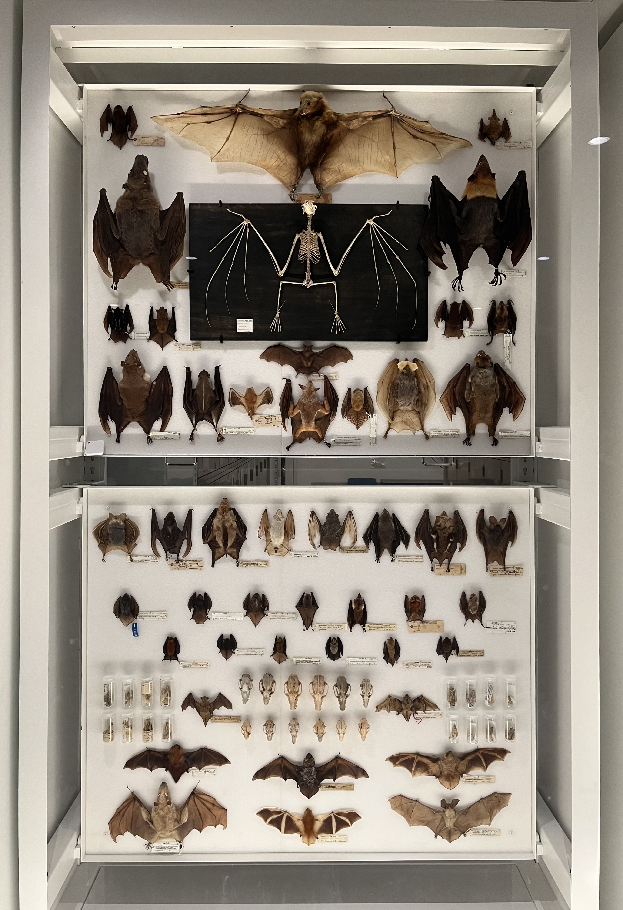
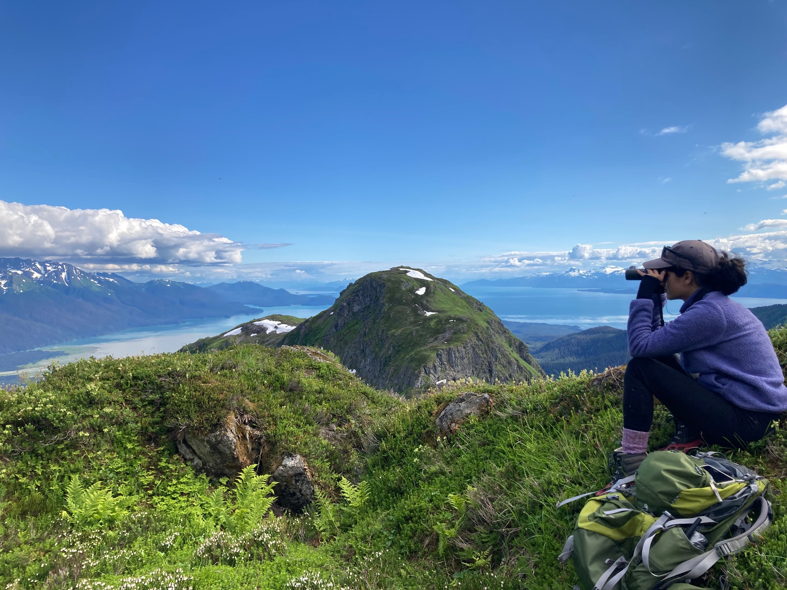
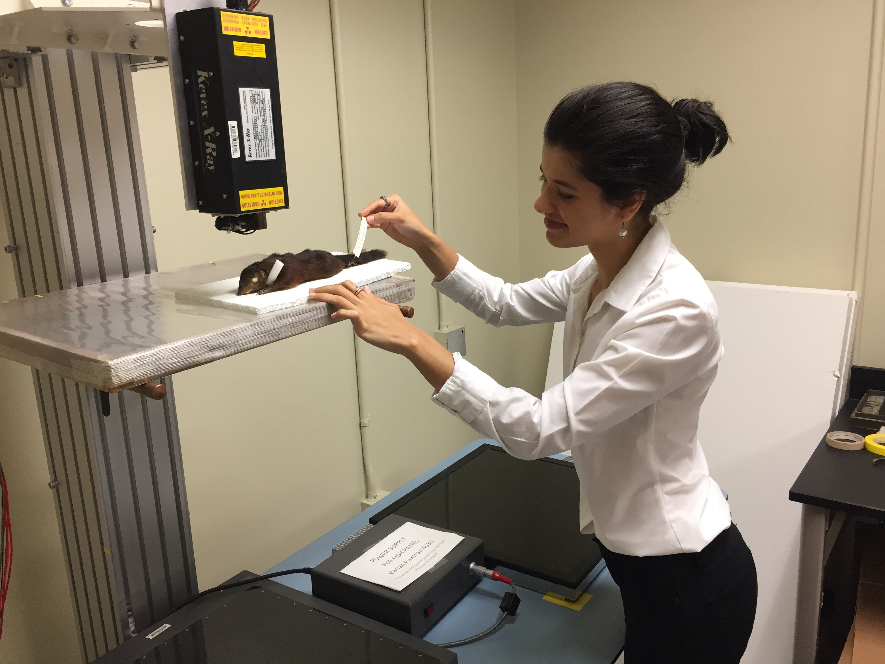

### Pathogen discovery in natural history museum collections

To understand the origins of zoonotic diseases, we typically rely on field-based sampling of wildlife. I am interested in a promising, complementary approach: pathogen detection in archived samples at natural history museums. These historical collections enable us to identify pathogens across space and time, offering a cost-effective, efficient, and proactive avenue of study. In one project, supported by 
<a href="https://www.viralemergence.org/" target="_blank">Verena</a>, <a href="https://acceleratescience.github.io/" target="_blank">Accelerate Science</a>, and <a href="https://www.c2d3.cam.ac.uk/" target="_blank">the Cambridge Centre for Data-Driven Discovery</a>, I detected viral RNA in tissue samples of bat specimens housed at the Field Museum of Natural History. Bat species were selected for screening based on predictive machine learning models of host suitability. You can read more about the project in a preprint <a href="https://doi.org/10.1101/2025.09.11.675601" target="_blank">here</a> and a blog post <a href="https://acceleratescience.github.io/machine-learning/2024/03/18/could-we-use-ai-to-find-bat-viruses-in-museum-specimens.html" target="_blank">here</a>.

  
In <a href="https://doi.org/10.64898/2026.03.22.713527" target="_blank">another study</a> based at the University of Alaska Museum, we screened historical rodent specimens for Borealpox virus (BRPV), a poxvirus first identified in a human patient in Alaska in 2015. At least seven additional BRPV cases have appeared in subsequent years, including one fatal case in 2023. We detected BRPV DNA in voles collected in Denali National Park in 1998, 17 years before the initial discovery of BRPV. While original investigations could not rule out the possibility of viral introduction to Alaska in 2015, our study strongly suggests that this virus has been present in a wildlife reservoir in the state for decades. This work, conducted in collaboration with the Alaska State Department of Public Health and U.S. Centers for Disease Control, demonstrates the value of using historical museum collections as time machines to understand viral emergence.

We also continue to collect and screen contemporary small mammals for poxviruses in both urban and remote regions of Alaska. In 2022 and 2023, I conducted field work with Dr. Link Olson at the University of Alaska Museum, focusing on hoary marmots (*Marmota caligata*) in Southeast Alaska.

 

### Fruit bat ecology and RNA viruses

My PhD research at the University of Cambridge (advised by <a href="https://www.vet.cam.ac.uk/directory/or226%40cam.ac.uk" target="_blank">Dr. Olivier Restif</a>) aimed to elucidate the connections between bat ecology and viral emergence, focusing on fruit bats (family Pteropodidae) and paramyxoviruses (including the zoonotic Hendra and Nipah viruses, which cause high fatality rates in humans). This project began with a <a href="https://doi.org/10.1371/journal.pntd.0013698" target="_blank">review and meta-analysis</a> of paramyxovirus sampling gaps in this system, followed by <a href=" https://doi.org/10.1002/ece3.70555" target="_blank">an analysis of longitudinal serological data</a> from *Eidolon helvum*, an enigmatic, highly mobile species. My <a href="https://www.medrxiv.org/content/10.64898/2026.06.30.26356960v1" target="_blank">final PhD chapter</a> pivoted to filoviruses (a family that includes Ebola and Marburg viruses), leveraging a large, long-term serological dataset to examine filovirus circulation in different bat species and potential spillover into human communities in Ghana. This research will inform future viral surveillance, bat conservation efforts, and public health measures.

### Biogeography and body size variation in South and Southeast Asian Mammals

My undergraduate thesis and ongoing related projects grew out of a <a href="https://news.yale.edu/2018/09/14/yale-smithsonian-internships-offer-exciting-research-opportunities" target="_blank">Yale-Smithsonian internship</a> I completed in 2018, focusing on ecogeographic variation in treeshrews (Scandentia). In collaboration with <a href="https://meml.yale.edu/" target="_blank">Dr. Eric Sargis</a> at Yale, I analyze multivariate morphometric data from museum specimens of treeshrews and colugos to clarify taxonomic boundaries and conservation priorities for these poorly studied mammals. We also use these data to investigate the (<a href="https://www.nature.com/articles/s41598-022-23774-w" target="_blank">often intertwined</a>) effects of biogeography and climate change on mammalian body size and shape. This work has resulted in five IUCN Red List reassessments, in addition to several scientific publications.

I grew up in India and am passionate about South Asian wildlife conservation. I serve as a species page contributor for Scandentia on the <a href="https://indiabiodiversity.org/" target="_blank">India Biodiversity Portal</a>, and I am the founder and administrator of the <a href="https://indiabiodiversity.org/group/Small_Mammals_of_India" target="_blank">Small Mammals of India micro-site</a>, a hub for aggregating citizen science data.
